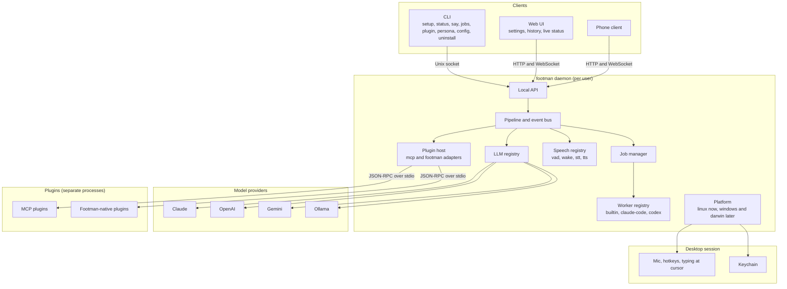

# Architecture

The process model from [design §4](../design.md#4-process-model). Clients talk to one per-user daemon through the local API. The daemon's parts reach out to model providers, the desktop platform, and plugins.

*Figure: one `footman` binary runs as a per-user daemon. The CLI, web UI and phone are clients of its local API. Plugins start lazily and stop when idle.*

