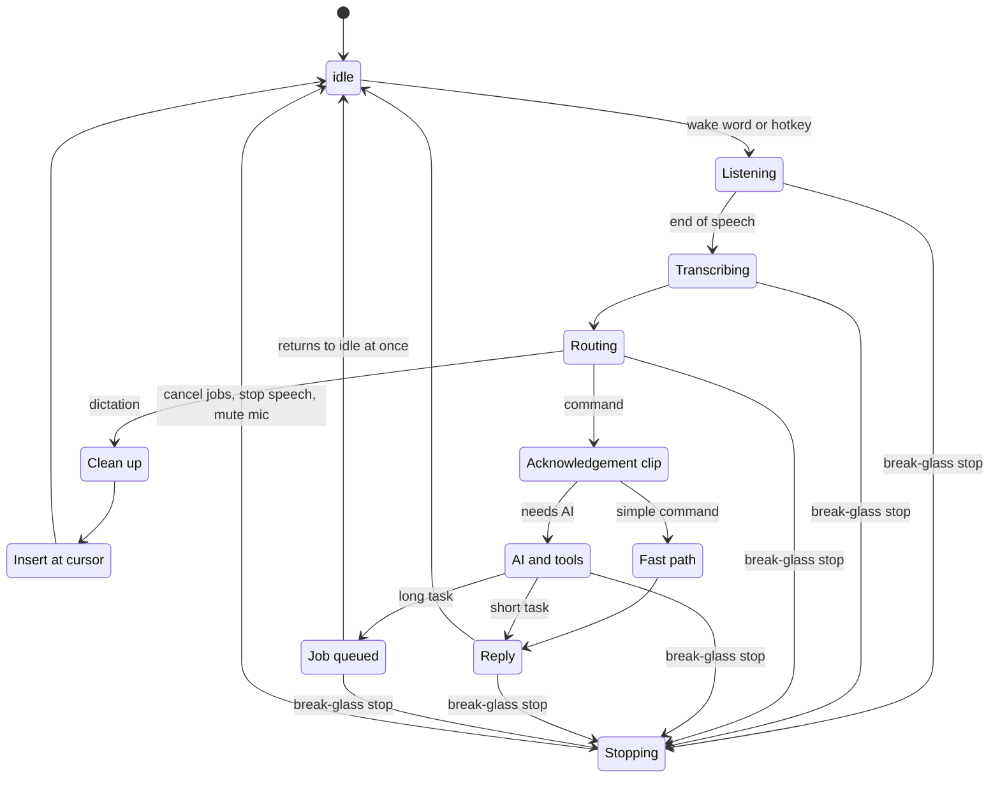

# Pipeline

The state machine from [design §5](../design.md#5-pipeline). A wake word or hotkey starts a turn. Dictation is inserted at the cursor. Commands get a fast path or the AI with tools. Long tasks move to the job manager, and the pipeline returns to idle at once.

*Figure: the break-glass stop ("Alfred, stop everything", wake word required, or the hotkey or tray icon) cancels jobs, stops speech and mutes the mic from any active state.*

