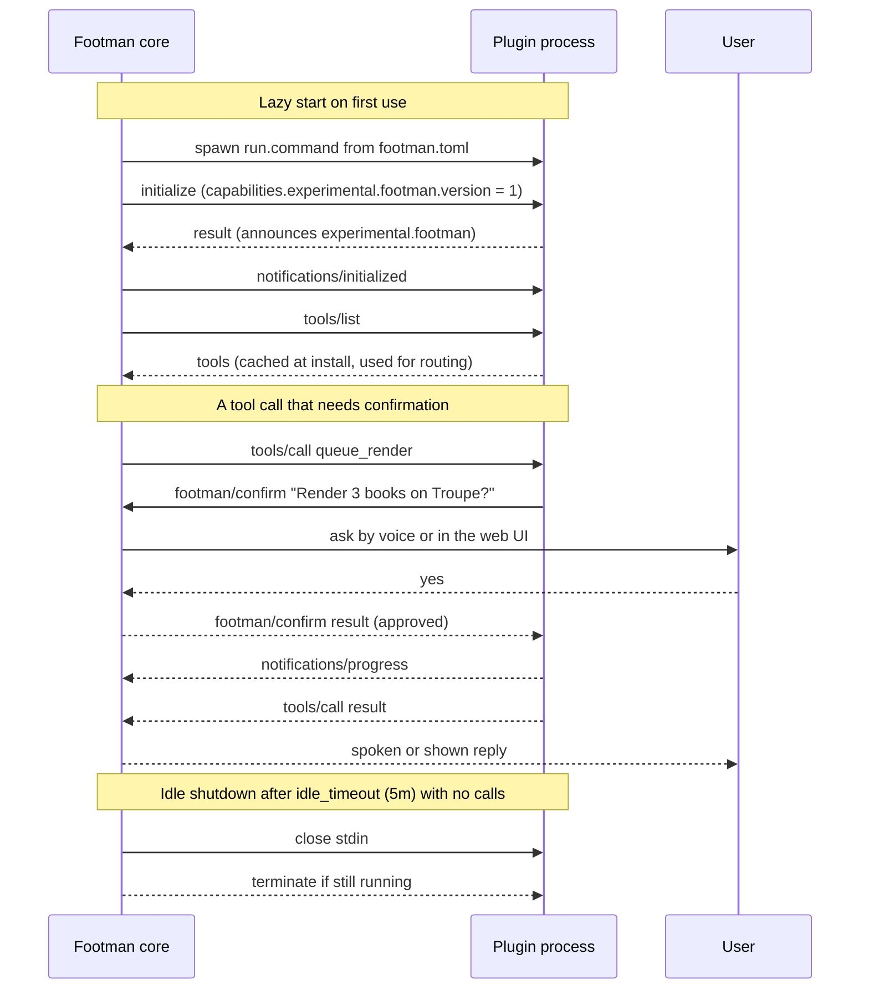

# Plugin handshake

The core ↔ plugin conversation from [design §26](../design.md#26-plugins-draft). Both sides speak JSON-RPC 2.0 over stdio with MCP's message shapes. A Footman-native plugin announces `experimental.footman` in its `initialize` result, and plain MCP servers simply don't.

*Figure: the plugin starts on first use, asks the user through the core during a tool call, and is shut down after the idle timeout.*

